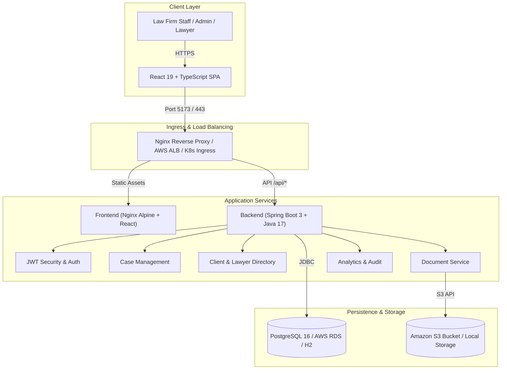

# Cloud-Based Law Firm Management System

[](https://openjdk.org/)
[](https://spring.io/projects/spring-boot)
[](https://react.dev/)
[](https://www.typescriptlang.org/)
[](https://www.postgresql.org/)
[](https://www.docker.com/)
[](https://kubernetes.io/)
[](https://www.ansible.com/)
[](https://aws.amazon.com/)
[](https://www.terraform.io/)
[](https://github.com/features/actions)

An enterprise-grade, cloud-native legal practice management system built with **Spring Boot 3**, **React 19 + TypeScript + Tailwind CSS**, **PostgreSQL**, and backed by complete DevOps automation (**Docker, Kubernetes, Ansible, AWS Terraform, CloudFormation, and GitHub Actions CI/CD**).

Designed for law firms, legal counsels, and corporate legal departments to manage client relationships, litigation case lifecycles, lawyer assignments, court hearing calendars, and multi-part evidentiary document repositories.

---

## Architecture Overview



---

## Core Capabilities

- **Stateless Authentication & RBAC**: JWT Bearer authentication with pre-seeded `ADMIN`, `LAWYER`, and `STAFF` roles.
- **Client Relationship Directory**: Track individual, corporate, non-profit, and government clients with consultation notes and history.
- **Lawyer & Counsel Management**: Track bar registration numbers, practice specializations, and real-time availability.
- **Legal Case Tracking**: Comprehensive case registration, court filings, hearing schedules, and multi-lawyer team assignments.
- **Hearing & Appointment Scheduling**: Real-time calendar, room allocations, agendas, and status tracking (`SCHEDULED`, `COMPLETED`, `CANCELLED`).
- **Evidentiary Document Repository**: Multi-part upload (PDF, DOCX, XLSX, Images), metadata indexing, and single-click raw file streaming download.
- **Live Analytics Dashboard**: Real-time KPI metrics, case status distribution charts, monthly filing trends, and security audit log streams.

---

## Demo Credentials & Seed Data

On startup, the system automatically initializes default administrator credentials and demonstration data:

- **Admin Email:** `admin@lawfirm.com`
- **Admin Password:** `Admin@123`
- **Pre-Seeded Records:**
  - Clients: `Aisha Rahman` (Corporate), `Ravi Sharma` (Individual)
  - Lawyers: `Priya Nair` (Corporate Law), `Harsh Mehta` (Family Law)
  - Cases: `LF-2026-001` (Corporate Contract Review, High Court of Mumbai)
  - Appointments & Activity logs pre-loaded in the calendar and dashboard.

---

## Local Development Setup

### Prerequisites
- **Java**: JDK 17 or higher
- **Node.js**: v18 or v20+ (LTS recommended)
- **Git**: 2.x+

### 1. Run Backend Service
Cross-platform Maven wrappers are included. No global Maven install is necessary.

```bash
cd backend

# Windows:
.\mvnw.cmd spring-boot:run

# Linux / macOS:
chmod +x mvnw
./mvnw spring-boot:run
```
- **Backend API:** `http://localhost:8081`
- **H2 Database Console:** `http://localhost:8081/h2-console`
  - JDBC URL: `jdbc:h2:mem:lawfirmdb`
  - User: `sa` | Password: *(blank)*

### 2. Run Frontend Application
In a separate terminal:

```bash
cd frontend
npm install
npm run dev
```
- **Frontend URL:** `http://localhost:5173`
- The Vite development server automatically proxies `/api` calls to `http://localhost:8081`.

---

## Docker & Docker Compose

Deploy the complete multi-tier production environment (Frontend, Backend, and PostgreSQL 16) with one command:

```bash
# Build and run entire stack in background:
docker-compose up --build -d

# View container status:
docker-compose ps

# Stream logs:
docker-compose logs -f

# Stop and tear down:
docker-compose down
```

| Service | Container Name | Port Mapping | Technology |
|---|---|---|---|
| **Frontend** | `lawfirm-frontend` | `5173:80` | Nginx 1.25 Alpine + React 19 Bundle |
| **Backend** | `lawfirm-backend` | `8081:8081` | Spring Boot 3 (Temurin 17 JRE) |
| **Database** | `lawfirm-postgres` | `5432:5432` | PostgreSQL 16 Alpine |

---

## Kubernetes (K8s) Deployment

Production Kubernetes manifests with declared namespaces, ConfigMaps, Secrets, PVCs, Deployments, and Ingress rules are located in `k8s/`.

```bash
# Deploy all resources via Kustomize:
kubectl apply -k k8s/

# Or deploy individually:
kubectl apply -f k8s/namespace.yaml
kubectl apply -f k8s/configmap.yaml
kubectl apply -f k8s/secrets.yaml
kubectl apply -f k8s/postgres-pvc.yaml
kubectl apply -f k8s/postgres-deployment.yaml
kubectl apply -f k8s/backend-deployment.yaml
kubectl apply -f k8s/frontend-deployment.yaml
kubectl apply -f k8s/ingress.yaml

# Check cluster pod status:
kubectl get pods -n lawfirm
```

---

## Ansible Automation Playbook

Automate provisioning of remote Linux application servers (Ubuntu 22.04 LTS / AWS EC2), including package updates, Docker installation, firewall rules, and container orchestration:

```bash
cd ansible

# 1. Update target server IP in inventory.ini:
# [app_servers]
# app1.lawfirm.internal ansible_host=YOUR_SERVER_IP ansible_user=ubuntu

# 2. Run playbook:
ansible-playbook -i inventory.ini playbook.yml
```

---

## AWS Cloud Infrastructure & CI/CD

### 1. Terraform (Infrastructure as Code)
Located in `terraform/`, provisions a complete AWS production topology:
- **VPC & Subnets**: Multi-AZ VPC across public and private subnets.
- **Amazon RDS**: Managed PostgreSQL 16 instance.
- **Amazon S3**: Private encrypted bucket for legal document storage.
- **Amazon ECR**: Container image repositories for backend and frontend.
- **AWS ECS Fargate**: Serverless container cluster with Application Load Balancer (ALB).

```bash
cd terraform
terraform init
terraform plan
terraform apply
```

### 2. AWS CloudFormation
For 1-click cloud deployment without Terraform:
```bash
aws cloudformation create-stack \
  --stack-name lawfirm-cloud \
  --template-body file://aws/cloudformation.yaml \
  --parameters ParameterKey=EnvironmentName,ParameterValue=production \
  --capabilities CAPABILITY_IAM
```

### 3. CI/CD Pipeline (GitHub Actions)
Codified in `.github/workflows/ci-cd-aws.yml`:
- **Build & Test**: Automated Java test suite execution and React bundle build on every push and PR.
- **Container Build**: Multi-stage Docker image builds on Ubuntu.
- **ECR Registry Push**: Automated login and push to Amazon Elastic Container Registry.
- **ECS Service Rollout**: Rolling deployment to AWS ECS Fargate tasks with zero downtime.

---

## REST API Reference

All protected endpoints require the HTTP Header: `Authorization: Bearer <JWT_TOKEN>`.

| Domain | Method | Endpoint | Description |
|---|---|---|---|
| **Auth** | `POST` | `/api/auth/login` | Authenticate user and receive JWT token. |
| **Auth** | `POST` | `/api/auth/register` | Register new staff or lawyer user. |
| **Dashboard** | `GET` | `/api/dashboard/metrics` | Retrieve real-time KPI metrics. |
| **Dashboard** | `GET` | `/api/dashboard/case-status` | Case counts grouped by status. |
| **Dashboard** | `GET` | `/api/dashboard/recent-cases` | 5 most recent legal cases. |
| **Dashboard** | `GET` | `/api/dashboard/activity-logs`| System-wide audit activity stream. |
| **Clients** | `GET` / `POST` | `/api/clients` | List all clients / Register new client. |
| **Clients** | `GET` / `PUT` / `DELETE` | `/api/clients/{id}` | Client detail, update, or safe delete. |
| **Lawyers** | `GET` / `POST` | `/api/lawyers` | List lawyers / Add lawyer to directory. |
| **Lawyers** | `GET` / `PUT` / `DELETE` | `/api/lawyers/{id}` | Lawyer detail, update, or safe delete. |
| **Cases** | `GET` / `POST` | `/api/cases` | List all cases / Create new legal case. |
| **Cases** | `GET` / `PUT` / `DELETE` | `/api/cases/{id}` | Case detail, update, or remove case. |
| **Appointments**| `GET` / `POST` | `/api/appointments` | List appointments / Schedule appointment. |
| **Appointments**| `GET` / `PUT` / `DELETE` | `/api/appointments/{id}` | Appointment detail, reschedule, or cancel. |
| **Documents** | `GET` / `POST` | `/api/documents` | List document metadata / Upload file. |
| **Documents** | `GET` | `/api/documents/{id}/download` | Stream raw binary document attachment. |
| **Documents** | `DELETE` | `/api/documents/{id}` | Delete document and remove physical file. |

---

## Project Structure

```text
Law_Firm/
├── .github/workflows/ci-cd-aws.yml    # GitHub Actions automated CI/CD pipeline
├── ansible/                          # Ansible inventory and provisioning playbook
├── aws/cloudformation.yaml           # AWS CloudFormation 1-click template
├── backend/                          # Spring Boot 3 Java 17 backend application
│   ├── .mvn/wrapper/                 # Cross-platform Maven wrapper
│   ├── Dockerfile                    # Multi-stage Maven + Temurin JRE container
│   ├── pom.xml                       # Maven build descriptor with PostgreSQL
│   └── src/main/java/com/lawfirm/app # Config, Controllers, DTOs, Entities, Repositories, Services
├── frontend/                         # React 19 + TypeScript + Tailwind CSS application
│   ├── Dockerfile                    # Multi-stage Node builder + Nginx Alpine runtime
│   ├── nginx.conf                    # Nginx reverse proxy configuration
│   └── src/                          # Pages, API client, Router, UI components
├── k8s/                              # Kubernetes manifests & Kustomize bundle
├── terraform/                        # Terraform AWS IaC (VPC, RDS, S3, ECR, ECS)
├── docker-compose.yml                # Docker Compose multi-service definition
└── README.md                         # Project documentation
```

---

## License

This project is licensed under the MIT License.
